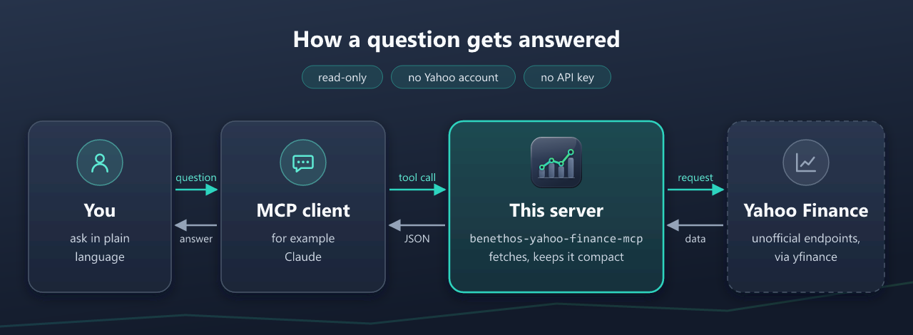

# Specification — Unofficial Yahoo Finance MCP Server

## 1. Purpose

An [MCP](https://modelcontextprotocol.io) server that gives MCP clients (e.g.
Claude Desktop) read-only access to Yahoo Finance market data. Data is sourced
through the [`yfinance`](https://github.com/ranaroussi/yfinance) library, which
talks to Yahoo's unofficial endpoints.

## 2. Scope

**In scope:** quotes (single and multi-symbol), historical OHLCV, company
profile and fundamentals (financial statements incl. trailing-twelve-month),
dividends and splits, shares outstanding, news, analyst recommendations,
estimates and rating changes, earnings, holders and insider activity, SEC
filings, the corporate calendar, options chains, fund/ETF profiles,
sector/industry browsing, and symbol lookup by name / ticker / ISIN.

**Out of scope (non-goals):** placing trades, real-time streaming, portfolio
persistence, authenticating to Yahoo or any paid data feed, write operations
of any kind.

## 3. Architecture



The same path in the code (`assets/render_icon.py` draws the picture above):

```
MCP client (Claude)  --stdio / HTTP-->  transport/  -->  server.py (MCPServer)
                                                              |
                                                    tools/<subject>.py
                                                  (schemas + descriptions)
                                                              |
                                                    yahoo/<subject>.py  --> cache.py
                                              (yfinance calls, error mapping)
                                                              |
                                          yfinance --> query1/2.finance.yahoo.com
```

`cli.py` resolves the settings, sets up the log, builds the server and hands
it to a transport. `tools/` and `yahoo/` have the same eight modules, one per
subject (quotes, company, analysts, ownership, options, funds, browse,
screener), so `tools/options.py` exposes exactly what `yahoo/options.py`
fetches.
`tools/status.py` is the ninth and has no twin: `server_status` asks Yahoo
nothing and answers from the process itself.

| Module | Responsibility |
|--------|----------------|
| `cli.py` | Command-line parser and `main()`: resolve settings, configure the log and the cache, build the server, hand it to `run_stdio` or `run_http`. |
| `__main__.py` | Enables `python -m benethos_yahoo_finance_mcp` (delegates to `cli.main`). |
| `settings.py` | Every `YF_MCP_*` variable and flag, resolved once into a `Settings` dataclass (flag > env > default), plus the default cache TTLs. The only module that reads the environment, apart from `NO_COLOR`, a terminal convention `logbook/formats.colours_wanted` reads for itself. |
| `server.py` | The server's identity and instructions, `build_server()`, and the `call_tool` override that logs refused arguments. |
| `prompts/` | The prompts a client offers a person, recipes in plain text that chain the tools (see §7a). `_base.py` holds the abstract `Prompt`, the `Symbol` argument and the shared `RESOLVE` and `RULES` texts, and each prompt is a subclass in the module of its name: `asset_analysis.py`, `compare.py`, `earnings_preview.py`, `etf_profile.py`, `dividend_calendar.py`, `find_symbol.py`. They ask Yahoo nothing and import nothing of the package. |
| `tools/` | The tools a client sees, thin: parameters, descriptions, and a call to the yahoo function of the same name. `_base.py` holds the `Symbol` parameter, the shared annotations and `register_tool`, which wraps every tool with its log line. `status.py` holds `server_status`, the one tool with no yahoo twin and no log line. |
| `yahoo/` | All yfinance usage, one module per subject. `tickers.py` builds the `Ticker` and holds the error mapping every subject shares. The only package that imports yfinance. |
| `cache.py` | Opt-in persistent result cache (SQLite) with per-tool TTLs. Off until `configure(settings)` enables it. |
| `formatting.py` | Convert pandas/yfinance output to compact, JSON-safe values. |
| `logbook/` | Every log line, as a function, and the one stderr handler. The only package that imports `logging` (see §4). |
| `transport/` | `stdio.py`, and `http.py`: the HTTP app with the DNS-rebinding policy and the optional bearer guard in front, served by uvicorn. stdio never touches the HTTP half. |
| `errors.py` | `ToolError`, `SymbolNotFoundError`, `RateLimitError`. |
| `py.typed` | PEP 561 marker. Without it a type checker skips the installed package and every annotation in it goes unused. |

### Layers

Each top-level module or package imports exactly what its row names.
`tests/test_layers.py` reads every import from the source and checks it
against this table, both ways, and it checks that this table and its own
copy agree, so a new module needs a row in both and a new or dropped import
changes its row.

<!-- layers:start -->
| Unit | May import |
|------|------------|
| `__init__.py` | — |
| `errors` | — |
| `settings` | — |
| `logbook` | — |
| `formatting` | — |
| `cache` | `__init__.py`, `settings`, `logbook` |
| `yahoo` | `errors`, `logbook`, `cache`, `formatting` |
| `tools` | `errors`, `logbook`, `yahoo` |
| `prompts` | — |
| `server` | `__init__.py`, `tools`, `prompts`, `logbook` |
| `transport` | `settings`, `logbook` |
| `cli` | `__init__.py`, `settings`, `logbook`, `cache`, `server`, `transport` |
| `__main__` | `cli` |
<!-- layers:end -->

`tools` never imports `formatting`: a tool returns what yahoo built. Only
`__main__` imports `cli`, and only `yahoo` imports yfinance. Packages are
entered only through their `__init__.py`: a name taken from another package
must be in its `__all__`, and no import reaches into another package's
submodules.

## 4. Transport & runtime

- **Transport:** selectable via `--transport`:
  - `stdio` (default) — local subprocess for Claude Desktop and similar.
  - `streamable-http` / `sse` — standalone, network-reachable HTTP service.
- **Logging:** always to stderr, one handler, installed by `cli.main` through
  `logbook.output.configure` and never at import, so under stdio stdout
  carries JSON-RPC only. `build_server` takes back the `RichHandler` the SDK's
  constructor installs, so a program that imports the package keeps its own
  logging. Every line is a function in `logbook/` (`lifecycle`, `calls`,
  `cache`, `upstream`), and nothing else imports `logging`, which
  `tests/test_logbook_catalog.py` checks along with the parameter vocabulary.
  - **How a line looks** (`logbook/formats.py`). Every line names its
    source short: `server`, `tools`, `yahoo`, `cache`, `uvicorn`, `http`, and
    any other library by its logger name. uvicorn calls its server log
    `uvicorn.error`, after the web servers' error log that holds everything
    a server says about itself, and written out a start read as a failure.
    Every line writes the time the same way, as ISO 8601 to the millisecond
    with its offset. Without a terminal, in a container log or the file
    Claude Desktop keeps, a line is plain:
    `2026-09-30T13:19:02.840+02:00 INFO     uvicorn: Started server process`.
    When stderr is a terminal and `NO_COLOR` is not set, the time is dim,
    the level in colour, the source in cyan and a request is method, path,
    status in colour and the client.
  - **Levels.** ERROR only from the SDK, with a traceback, for an exception
    that is not a `ToolError`. WARNING for a tool call that raised, a Yahoo
    rate limit, arguments a schema refused, a cache file that failed, an
    unguarded port, a token under stdio, an unusable setting. INFO for
    startup, the cache state, one line per tool call and a stop by Ctrl+C.
    DEBUG for every answered HTTP request.
  - **Ctrl+C.** uvicorn shuts down cleanly and then raises the interrupt
    again, so the process ends as interrupted. `cli.main` catches it, logs
    `Stopped by an interrupt` and exits with 130, stdio included. Uncaught it
    printed a traceback after `Finished server process`. SIGTERM, which
    `docker stop` sends, is not affected: Python turns only SIGINT into an
    exception.
  - **One line per call**, written by the wrapper `register_tool` puts around
    every tool: `get_history SAP.DE 250 rows, truncated, 412 ms`, with
    `cached` appended when the result cache answered (the cache notes that in
    a context variable). `server_status` is registered without the wrapper
    and writes none: a status question is not an activity.
  - **What a line may carry.** A symbol or a key, since both are public
    identifiers, with printable characters only and cut at 32, because the
    caller chose them and the line is written before Yahoo says whether they
    exist. A line break would forge a second line, an escape sequence would
    reach a terminal. Never the bearer token, a search query (free text a person
    typed, the line gives the number of matches), a URL's query string,
    anything from Yahoo's answer, or the text of an error this server raised,
    which is written for the model. A line names the error's class instead.
    A line another library wrote, which may quote what a caller sent, is
    reduced to printable characters on its way to stderr, so it cannot forge
    a second line either.
  - **Other loggers.** The chosen level applies to this package and to
    uvicorn's request log only. The root logger stays at WARNING, so every
    other library, including one nobody thought of, says only what went
    wrong. `mcp`, `sse_starlette`, `curl_cffi`, `urllib3`,
    `peewee`, `httpx` and `httpcore` are also pinned at WARNING by name:
    `mcp` quotes every failed call's text at INFO and `sse_starlette` logs
    every tool result in full at DEBUG. uvicorn's server log is held at INFO
    for its startup lines. uvicorn gets no
    handlers of its own. Its request log reaches the same stderr handler
    without the query string, at INFO only for a refused request (status 400
    and up, with the address that tried) and at DEBUG for all. `yfinance` is
    held at CRITICAL, which is silent: it logs an unknown symbol as up to four
    ERROR lines, one of them Yahoo's whole answer body, after the tool has
    already said "not found" in its own line. What yfinance raises still
    reaches the log through that line, and an unexpected exception through
    `wrap_upstream` with its traceback. `wrap_upstream` hands the model the
    text of yfinance's own exceptions only. A network error is named by
    class, since its text can carry the URL with Yahoo's crumb, and anything
    else by class as well.
  - **Python warnings** go to stderr as Python prints them, outside the
    line format.
- **CLI flags:** `--version`, `--transport`, `--host` (default 127.0.0.1), `--port`
  (default 8000, 1-65535, checked once an HTTP transport binds it), `--path`
  (default `/mcp`, `/sse` for sse), `--allowed-hosts`, `--allowed-origins`,
  `--log-level`, and the cache flags `--cache`/`--no-cache`, `--cache-dir`,
  `--cache-max-entries <N>`, `--cache-ttl <NAME>=<SECONDS>` (see §8a).
  Host/port/path/allow-list apply to the HTTP transports only. For stdio they
  are ignored.
- **Environment:** every CLI flag has an env-var equivalent (CLI > env >
  default): `YF_MCP_TRANSPORT`, `YF_MCP_HOST`, `YF_MCP_PORT`, `YF_MCP_PATH`,
  `YF_MCP_ALLOWED_HOSTS`, `YF_MCP_ALLOWED_ORIGINS`, `YF_MCP_LOG_LEVEL`, and the
  cache vars `YF_MCP_CACHE`, `YF_MCP_CACHE_DIR`, `YF_MCP_CACHE_MAX_ENTRIES`,
  `YF_MCP_CACHE_TTL_<NAME>`.
  `YF_MCP_BEARER_TOKEN` is the one exception with no flag: an argument is
  visible in the process list to every other user on the machine. All of them
  are read once, by `settings.load_settings`. A value that cannot be used
  falls back to its default with a warning in the log, a flag value that
  cannot be used is a usage error. The port is the exception: a value
  outside 1 to 65535, from the flag or the environment, stops an HTTP start
  as a usage error, since a server that silently moved to 8000 would listen
  on the wrong port.
- **Entry points:** `python -m benethos_yahoo_finance_mcp` or the
  `benethos-yahoo-finance-mcp` console script.
- **Python:** 3.11-3.15, all covered by the CI matrix.
- **HTTP security:** an **optional** bearer token. With
  `YF_MCP_BEARER_TOKEN` set, every HTTP request must carry
  `Authorization: Bearer <token>` or gets HTTP 401. A single shared secret
  compared in constant time, not an OAuth flow: this server speaks for nobody
  and has no user to authorize. Off by default, since the ordinary case is a
  loopback bind on the machine that uses it. stdio ignores it. A token does not
  make a port safe to publish - bind to `0.0.0.0` only on trusted networks and
  front it with a proxy that authenticates. The guard sits in front of the
  whole ASGI app and lets only the lifespan scope through unchecked. A
  WebSocket handshake is closed with 1008 before it is accepted, and any
  other scope type gets no answer, so a route the SDK adds later is not
  open by default.
  The MCP HTTP transport also runs a DNS-rebinding `Host`/`Origin` guard. It is
  derived from the actual bind host and passed to the SDK's app builder
  (`streamable_http_app` / `sse_app`, via `transport.http_app`) as an
  explicit argument: a localhost bind keeps the protective localhost allow-list
  (decided by address, so `LOCALHOST`, `127.0.0.2` and `[::1]` count, and
  `YF_MCP_HOST` is trimmed first),
  an exposed bind accepts any `Host` unless `--allowed-hosts` /
  `--allowed-origins` narrow it (mismatches get HTTP 421). Either list is
  derived from the other when only one is given. stdio has no HTTP
  surface and is handed no transport options at all. The image sets
  `YF_MCP_ALLOWED_HOSTS` to the loopback names and the compose service name,
  and both compose files set it again, because the image binds `0.0.0.0` and
  the guard would otherwise be off while the port sits on the host's
  loopback, reachable by a rebound browser page. A proxy's name or any other
  address the container is reached by has to be added, or it gets 421.
  Production appends `YAHOO_FINANCE_MCP_DOMAIN` when it is set, the name
  clients use through Caddy (see Deployment), which would otherwise get 421.
  `tests/test_cli.py` holds it to that.
- **Deployment:** everything for containers sits in `containers/`. The
  `Dockerfile` in `containers/images/yahoo-finance-mcp/` (multi-stage,
  non-root, healthcheck, dependencies installed reproducibly from `uv.lock`
  via uv, build context the repository root) hosts the server over
  streamable-HTTP on port 8000. The image is configured entirely via env vars
  (no default CMD args) and persists its cache to a `/cache` volume. Two
  compose files run it: `containers/production/` pulls the published image at
  the version `.env` names, required and without a default, and needs no
  clone, `containers/development/` builds from the checkout under a project
  name and host port of its own (8001), so both run side by side. Both fix
  the port inside the container at 8000 under `environment:`, where it wins
  over `.env`, since the port mapping and Caddy forward to that number and
  the health check reads the same variable. The port on the host is
  `YAHOO_FINANCE_MCP_PORT`. Secrets such
  as the bearer token go in an optional `.env` beside the compose file, read
  through `env_file` and ignored by git and the build context, with
  `containers/production/.env.example` as the tracked template. Only Compose
  (or `docker run --env-file`) reads it, the server itself loads no file.
  Both publish the port on **127.0.0.1 only**, drop every Linux capability
  and set `no-new-privileges`, since the server runs as a non-root user on a
  high port and needs none, run on a read-only root file system with a tmpfs
  for `/tmp` and for `yfinance`'s cookie and time zone cache in the home
  directory, and cap the log Docker keeps of the container at 5 files of
  10 MB, since uvicorn writes a line per request and Docker's default keeps
  everything. CI asserts the loopback port, the read-only root, that
  development builds and that production pulls the published image.
  Drop the loopback prefix only behind a reverse proxy that authenticates, or
  at the very least with `YF_MCP_BEARER_TOKEN` set.
  Production brings that proxy along under the compose profile `https`
  (`COMPOSE_PROFILES=https` in `.env`): Caddy, configured by the `Caddyfile`
  beside the compose file, on port 443 of every address, TCP and, for
  HTTP/3, UDP. Port 80 is not published and Caddy redirects nothing, so a
  client set up with `http://` fails at once instead of sending its token in
  the clear first. `YAHOO_FINANCE_MCP_HTTPS_PORT` moves the host side of
  both mappings when 443 is taken, and the domain stands in the allow-list
  alone and with any port, since Caddy hands on the client's `Host`. It
  forwards to the server by service name over the
  compose network, so the server's port stays on 127.0.0.1. The domain comes
  from `YAHOO_FINANCE_MCP_DOMAIN`, the certificate from one of three
  snippets picked by `YAHOO_FINANCE_MCP_TLS`: `internal` (default, Caddy's
  own CA, for a private network), `files` (`secrets/tls/cert.pem` and
  `key.pem`, ignored by git) or `acme` (a public CA, which needs the name in
  public DNS and port 443 reachable from the internet, whatever port Caddy
  has on the host). A request without an `Authorization` header
  gets 401 from Caddy and never reaches the server, which checks the token
  of every other. Set the token with the profile, since nothing in the stack
  enforces it: without one Caddy still starts, and a request with any
  `Authorization` header reaches a server that has no token to compare. The
  server trusts no forwarded header, so its log names Caddy's address for a
  refused request, not the client's. Compose cannot require the domain for
  one profile only, since `:?` fails every start without it, so Caddy's
  command checks it first and stops with a message naming it. Caddy runs
  read-only with a tmpfs for `/tmp`, every capability dropped except
  `NET_BIND_SERVICE`, `no-new-privileges` and the same log cap, and keeps
  certificates and the ACME account in the volumes `caddy-data` and
  `caddy-config`. It starts once the server reports healthy.

## 5. Data source rules

- Single source: `yfinance`. No other provider, no direct HTTP scraping.
- One cache layer: successful tool **results** are cached persistently with
  per-tool TTLs (see §8a). `yahoo.tickers.get_ticker` builds a new
  `yf.Ticker` for every call and shares none. The SDK runs the sync tools in
  worker threads, and a `Ticker` fills its lazily loaded fields without a
  lock, which yfinance promises nothing about. Building one sends no request
  for a ticker. For an ISIN-shaped symbol the constructor looks it up through
  Yahoo's search, and yfinance keeps that answer in a cache file of its own.
  requests-cache is **not** usable here — yfinance uses curl_cffi and rejects
  caching sessions — so the result cache operates on our normalized output,
  not on HTTP responses.
- Symbol resolution (name / ticker / ISIN) uses `yfinance.Search`, and the same
  endpoint handles all three input kinds. The `search` tool calls it directly.
  For an ISIN passed as a symbol, `yf.Ticker` calls it on its own (see §6).

## 6. Symbol model

- All `get_*` tools pass the given `symbol` through to yfinance unchanged
  apart from trimming and uppercasing. The server itself resolves nothing
  (Variant A) and never assembles or rewrites a symbol.
- A symbol has at most 32 characters, which the schema says (`maxLength`), and
  must have the shape Yahoo uses: letters, digits and `. - ^ = &`, at least
  one letter or digit among them, as in `^GSPC`, `EURUSD=X`, `BRK-B`,
  `M&M.NS`. `yahoo.tickers.get_ticker` answers
  anything else with `SymbolNotFoundError` before yfinance is asked, since the
  symbol goes into the path of Yahoo's URLs. 128 symbols from 25 live
  searches across markets, futures, currencies and crypto all fit, checked
  2026-09-30.
- In practice that accepts both a **Yahoo ticker** (`AAPL`, `SAP.DE`) and a
  **plain ISIN** (`US0378331005`). The ISIN is resolved by yfinance, not by
  this server and not by the data endpoints: `yf.Ticker` recognises anything
  shaped like an ISIN (`^[A-Z]{2}[A-Z0-9]{9}[0-9]$`), looks it up through
  Yahoo's search in its constructor and uses the ticker found from then on.
  Probed 2026-08-16: all 18 symbol-taking tools return correct data for an ISIN.
  It still rests on an unofficial search endpoint, so it is **observed
  behaviour, not a guarantee** — it did not work at all when this section was
  first written, and it can change back. When the search finds nothing the
  constructor raises, and the tool answers with `SymbolNotFoundError`.
- A **company name** is not a symbol. Callers resolve one via `search` and pass
  back the `symbol` it returns.
- Every tool echoes the `symbol` it was given, uppercased, so the answer can
  always be matched to the question. `get_company_info` is the one tool that
  also learns Yahoo's resolved ticker, and reports it as `resolved_symbol` when
  it differs from the input — an ISIN in returns the ISIN plus the ticker it
  stands for.
- **WKNs resolve nowhere**, not through the tools and not through `search`
  (five probed, zero hits). Yahoo has no lookup for them.

## 7. Tools

All tools are read-only, and each one carries the MCP annotations
`readOnlyHint: true` and `openWorldHint: true` (one shared `ToolAnnotations`
in `tools/_base.py`, set by `register_tool`), except `server_status`, which
asks Yahoo nothing and carries `openWorldHint: false`. `destructiveHint` and
`idempotentHint` are omitted because the spec defines them only for tools
that are not read-only. Each tool also has a short `title` (e.g. "Stock
screener" for `screen`), which a client shows a person in place of the name.
The model reads the name and the description, not the title. `symbol`
always means a Yahoo ticker or an ISIN (see §6). The four exceptions among
the data tools are `get_sector` / `get_industry`, which take a
sector/industry **key** (e.g. `technology`, `semiconductors`), `get_market`,
which takes a market key (e.g. `US`), rather than a symbol, and `screen`,
which takes filters and returns symbols. `server_status` takes none of
these, it describes the server (see the end of the table).

| Tool | Inputs | Output (shape) |
|------|--------|----------------|
| `search` | `query` (name/ticker/ISIN, at most 200 characters), `limit` 1-25 (=8) | list of `{symbol, name, exchange, type, sector, industry}` |
| `get_quote` | `symbol` | `{symbol, currency, exchange, quoteType, lastPrice, previousClose, open, dayHigh, dayLow, lastVolume, marketCap, 50/200d avg, yearHigh/Low, yearChange}` |
| `get_quotes` | `symbols[]` (≤50) | `{count, quotes[{symbol, currency, lastPrice, previousClose, open, dayHigh, dayLow, marketCap}], not_found[], truncated}` |
| `get_history` | `symbol`, `period` (=1mo), `interval` (=1d), `start?`, `end?` | `{symbol, interval, period, start, end, count, truncated, rows[]}` (OHLCV, ≤250 rows, tail kept) |
| `get_company_info` | `symbol` | curated profile + key statistics, plus `resolved_symbol` when the input resolves to a different ticker (i.e. for an ISIN, see §6) |
| `get_financials` | `symbol`, `statement` (income/balance/cashflow), `freq` (annual/quarterly/ttm — ttm income/cashflow only) | `{symbol, statement, freq, rows[]}` (every line item, columns = period-end dates as `YYYY-MM-DD`, equity-only) |
| `get_dividends` | `symbol` | `{symbol, dividends[], splits[]}` (both empty for an instrument that never paid or split, an unknown symbol raises) |
| `get_news` | `symbol`, `limit` 1-50 (=10) | `{symbol, count, source, articles[{title, summary, publisher, published, url}]}` (`source` `ticker`, or `search` when the ticker has none: the articles Yahoo's search tags with the symbol, `summary` null) |
| `get_recommendations` | `symbol` | `{symbol, price_targets, recommendation_trend[]}` (trend rows keyed by `period`) |
| `get_options` | `symbol`, `expiration?` | without `expiration`: `{symbol, expirations[]}`, with it: `{symbol, expiration, truncated, calls[], puts[]}` (≤60 strikes per side, centred on the money, rows keyed by `contractSymbol`) |
| `get_earnings` | `symbol`, `limit` 1-50 (=12), `methodology` `gaap`/`normalized` (=Yahoo's default) | `{symbol, earnings_dates[], earnings_history[]}` (equity-only, `methodology` applies to the history and each row names it) |
| `get_estimates` | `symbol`, `methodology` `gaap`/`normalized` (=Yahoo's default) | `{symbol, earnings_estimate[], revenue_estimate[], eps_trend[], eps_revisions[], growth_estimates[]}` (equity-only, `methodology` applies to the three EPS tables and each row names it) |
| `get_upgrades_downgrades` | `symbol`, `limit` 1-100 (=50) | `{symbol, changes[]}` (rating changes, newest first, equity-only) |
| `get_holders` | `symbol`, `limit` 1-100 (=25) | `{symbol, major_holders[], institutional_holders[], mutualfund_holders[]}` (top holders first, equity-only) |
| `get_insider_activity` | `symbol`, `limit` 1-100 (=50) | `{symbol, transactions[], purchases_summary[], roster[]}` (transactions newest first, equity-only) |
| `get_sec_filings` | `symbol`, `limit` 1-100 (=25) | `{symbol, count, filings[{date, type, title, url, exhibits}]}` (equity-only) |
| `get_calendar` | `symbol` | `{symbol, calendar{}}` (next earnings/dividend dates + estimate ranges, equity-only) |
| `get_shares` | `symbol`, `start?`, `end?`, `limit` 1-250 (=50) | `{symbol, count, shares[{date, shares}]}` (most recent kept, last 18 months unless `start` is given) |
| `get_fund_data` | `symbol`, `limit` 1-100 (=25) | `{symbol, description, fund_overview, key_figures{expense_ratio, category_expense_ratio, holdings_turnover, total_assets, ytd_return, three_year_average_return, five_year_average_return}, asset_classes, sector_weightings, top_holdings[]}` (fund/ETF-only, ratios and returns as fractions, a figure Yahoo lacks left out) |
| `get_sector` | `key` (sector key), `limit` 1-100 (=25) | `{key, name, index_symbol, overview, top_companies[], top_etfs, top_mutual_funds, industries[]}` (module-level, not a symbol) |
| `get_industry` | `key` (industry key), `limit` 1-100 (=25) | `{key, name, index_symbol, sector_key, sector_name, overview, top_companies[], top_performing_companies[], top_growth_companies[]}` (module-level, not a symbol) |
| `get_market` | `key` (market key, =US) | `{key, status, count, indices[{symbol, shortName, fullExchangeName, marketState, regularMarketPrice, regularMarketPreviousClose, regularMarketChange, regularMarketChangePercent}]}` (module-level, `status` only for `US`, null elsewhere) |
| `screen` | `filters[{field, op, value}]` (up to 10, all must hold), `sort_by` (=market_cap), `sort_desc` (=true), `limit` 1-100 (=25), `offset` 0-9900 (=0) | `{total, count, offset, matches[{symbol, name, exchange, currency, price, change_percent, market_cap, pe_ratio, price_to_book, eps, dividend_yield, change_52w_percent, avg_volume_3m}]}` (empty columns left out, module-level, see §12) |
| `server_status` | `details` (=false) | plain text, one `key: value` per line: `name`, `version`, `transport`, `python`, `mcp`, `uptime_seconds`, and with `details` the lines `details:`, `yfinance` (the installed version, which can differ between two installations of one server version) and `upstream:` with `reachable` (yes/no/unknown) and `checked_seconds_ago` (or `never`), no `token_set`, since Yahoo is a public API and takes no key |

`server_status` never asks Yahoo. Its upstream lines say how the last
request ended, which `yahoo/tickers.py` remembers (`last_answer`): reached
when an upstream block ran through, ended in `not_found` or yfinance raised
about the data, not reached on a rate limit or a network error. A cached
result asks nobody and changes nothing, and after a restart the answer is
`unknown` until the first request. The tool's description says that an
answer holds for the moment it was given, so a model asks again after a
restart or an update rather than quote an earlier version.

### Parameter descriptions

Every tool parameter carries a human-readable description and constraints via
`Annotated[..., Field(description=..., ge=..., le=...)]` so the client receives
a precise input schema. Closed sets such as the valid `interval` or
`statement` values are listed in the parameter's description, not as a schema
`enum`, and a value outside the set is refused by the tool with a message that
names the set. The listing goes out without the `title` keys pydantic puts on
every argument model and field (`_Server.list_tools` strips them), since a
client shows the tool's own title and the model reads descriptions.

## 7a. Prompts

Six prompts in `prompts/` are recipes a person picks in the client, Claude
Desktop from the "+" menu, Claude Code as a slash command. Each returns one
user message that names the tools to call, in which order, and the traps of
the data to mind. A prompt asks Yahoo nothing and writes no log line, the
tool calls it leads to write theirs. The four data recipes end with the same
rules: currencies are never converted, London prices are in pence, the data
may be delayed, a missing figure is named, and no buy, sell or hold
recommendation is given. Judging an instrument is left to the person, in
line with the read-only scope of §2.

`dividend_calendar` is the one recipe that calculates. It converts every
amount to one currency and forecasts the coming months by fixed rules: the
pay date from the gap `get_calendar` reports or else 14 days and marked
estimated, the payments of the last 365 days recurring without growth,
gross amounts, and every gap listed. It is the only prompt that takes
personal data, the share count of each position. **The share counts reach
this server** as part of the `positions` argument, and with the HTTP
transports that means the machine that hosts it. The server puts them into
the text and nowhere else: no tool receives them, Yahoo never sees them, and
no log line carries them (a test renders the prompt with a count and looks
for it in every log record). The text tells the model to pass them to no
tool. `positions` takes any form a model can read, `SAP.DE:50`, `50x
IE00B4L5Y983` or rows pasted from a bank export with columns of their own,
decimal commas included. Whatever else such rows carry, an account number
for one, reaches the server the same way, so the text tells the model to
ignore every column but the instrument and the count, and the README asks
the person to leave the account number out.

| Prompt | Arguments | Tools it chains |
|--------|-----------|-----------------|
| `asset_analysis` | `symbol` | `get_quote`, then by `quoteType` for a stock `get_company_info`, `get_recommendations`, `get_calendar`, `get_shares`, `get_financials` (annual income), `get_news` and `get_history` 1y in one block, for a fund `get_fund_data` and `get_history`, for crypto `get_history` only. Own calculations: distance to every target, share count implied by the market cap against the diluted average shares of the last annual report, a multi-year table, price to sales for a loss |
| `compare` | `symbols` (comma-separated), `period` (=1y) | `get_quotes`, `get_history` and `get_company_info` for each |
| `earnings_preview` | `symbol` | `get_calendar`, `get_earnings`, `get_estimates` (one `methodology` for both), `get_upgrades_downgrades` |
| `etf_profile` | `symbol` | `get_fund_data`, `get_quote`, `get_history` 5y monthly when a return is missing |
| `dividend_calendar` | `positions` (symbol:shares, comma-separated), `year?` (=current), `currency` (=EUR) | `get_dividends` each, `get_calendar` for single stocks, `get_quote` for each listing's currency and each exchange rate |
| `find_symbol` | `query`, `exchange?` | `search` with limit 25, a WKN named as unresolvable |

Each recipe resolves a company name through `search` first. Every argument is
a string, as MCP prompt arguments are. `tests/test_prompts.py` checks every
tool and field a recipe names against what the server registers and returns,
and the bundle manifest lists the prompts with their text (see
`tests/test_mcpb.py`).

**Every prompt is a plain template.** Each argument goes into the text as it
came, an optional one defaults to `""`, and the text says in words what an
empty one means (`Period:  (one year, 1y, when empty)`). No condition picks
another sentence and no default stands in for an empty value. The reason is
how Claude Desktop treats the manifest's prompts, measured on 2026-11-11 with
Claude Desktop 5.1231.2 on Windows from its logs, on another MCP server with
three bundles that differed only in the manifest:

- The "+" menu lists every prompt the server offers, declared or not.
- Without `prompts_generated`, a prompt the manifest does not declare is
  refused when it is attached ("Failed to attach prompt").
- A declared prompt is checked against its text in the manifest, with the
  arguments put in. An optional argument left empty is put in as `""`, and a
  text that differs is refused.
- With `prompts_generated: true` nothing is checked, declared or not.

The pinned bundle declares its prompts, so a default like `"1y"` or a
sentence chosen by an `if` made `compare`, `dividend_calendar` and
`find_symbol` fail there whenever an optional argument stayed empty. Running
the server from a checkout carries no manifest and showed nothing.
`tests/test_prompts.py` renders every prompt with its optional arguments left
out, empty and filled in, and compares each with its template.

`asset_analysis` takes from the asset-analysis skill what checks and
calculates and leaves out what judges: an outlook by horizon and a case for
or against. Its share count check compares the count behind the market cap
with the diluted average shares of the last annual report, since every other
count the tools return is the same one (§12). A year of buybacks or issues
moves the two a few percent apart, so it speaks up past ten percent only.

A prompt is started by the person. The model cannot call one and does not
see the list, so nothing a recipe says reaches a conversation in which it
was not picked. That is why the rules that must always hold stay in the tool
descriptions and parameters (§7), and a recipe only adds an order and a
check on top. The texts are English, the answer follows the language the
person adds to the message.

## 8. Output format

- Default output is **compact JSON** (JSON-safe dicts/lists). The one
  exception is `server_status`, which answers in plain text without a
  structured copy (§7). A result travels twice, as `structuredContent` and
  as one text block holding the same JSON without indentation
  (`tools/_base.py`, `_packed`). Left to the SDK the text block is indented
  by two spaces, two fifths more bytes for what Claude Desktop hands the
  model. The `search` list is wrapped as `{"result": [...]}` in the
  structured copy, as its output schema says.
- `formatting.to_jsonable` normalizes `NaN`/`inf` -> `null`, `Timestamp`/
  `datetime` -> ISO-8601 string, numpy scalars -> native, and recurses through
  containers.
- Tabular results are row-capped (`MAX_ROWS = 250`, tighter per tool) to stay
  within the client's token budget. Which rows survive a cut depends on the
  shape: a time series keeps its tail (the most recent rows), a list ranked
  from the top keeps its head (holders, insider transactions, rating
  changes, top companies), and an option chain keeps the window around the
  money. A financial statement is a set of line items with no safe end to
  drop, so it is not cut at all. `get_history`, `get_quotes` and
  `get_options` report a `truncated` flag, `screen` the `total` number of
  matches with `offset` for the next page, the rest cap silently, and the
  server instructions say so.
- Column labels that are midnight timestamps, the period ends of a
  statement, are keyed by their plain ISO date (`2025-09-30`), since every
  row repeats every key.

## 8a. Result cache (`cache.py`)

- Caches the **normalized tool results** (not HTTP responses) in a SQLite file
  so they survive restarts, and each tool category has its own TTL.
- Cache names (the `<NAME>` in `--cache-ttl <NAME>=<SECONDS>` /
  `YF_MCP_CACHE_TTL_<NAME>`) and default TTLs:

  | Name | Tool | Default TTL |
  |------|------|-------------|
  | `quote` | `get_quote` | 30 s |
  | `quotes` | `get_quotes` | 30 s |
  | `history` | `get_history` | 10 min |
  | `news` | `get_news` | 10 min |
  | `options` | `get_options` | 10 min |
  | `screen` | `screen` | 10 min |
  | `search` | `search` | 1 h |
  | `company_info` | `get_company_info` | 6 h |
  | `dividends` | `get_dividends` | 6 h |
  | `recommendations` | `get_recommendations` | 6 h |
  | `earnings` | `get_earnings` | 6 h |
  | `estimates` | `get_estimates` | 6 h |
  | `upgrades_downgrades` | `get_upgrades_downgrades` | 6 h |
  | `insider_activity` | `get_insider_activity` | 6 h |
  | `sec_filings` | `get_sec_filings` | 6 h |
  | `calendar` | `get_calendar` | 6 h |
  | `financials` | `get_financials` | 24 h |
  | `holders` | `get_holders` | 24 h |
  | `shares` | `get_shares` | 24 h |
  | `fund_data` | `get_fund_data` | 24 h |
  | `sector` | `get_sector` | 24 h |
  | `industry` | `get_industry` | 24 h |
  | `market` | `get_market` | 60 s |
- **Opt-in: off by default.** Every call asks Yahoo anew (§5), so the cache
  is what makes a repeat cheap, across restarts and as rate-limit protection.
  It stays off because the ordinary case is an interactive stdio session,
  where a repeat is rare and fresh data counts for more, and a file on disk
  is the operator's choice. Enable it with `--cache` / `YF_MCP_CACHE=1`.
- Disabled until `configure(settings)` is called (which `cli.main` does), so
  importing the package or calling the yahoo functions in tests/library use
  does not touch disk unless caching is explicitly enabled.
- Config precedence CLI > env > default: `--cache/--no-cache` (`YF_MCP_CACHE`),
  `--cache-dir` (`YF_MCP_CACHE_DIR`), `--cache-max-entries <N>`
  (`YF_MCP_CACHE_MAX_ENTRIES`, default 10 000, at least 1),
  `--cache-ttl <NAME>=<SECONDS>` (`YF_MCP_CACHE_TTL_<NAME>`). A TTL of `0`
  bypasses the cache for that tool, reading included, so an entry stored
  under an earlier TTL is not served.
- Only successful, non-empty returns are cached. Exceptions propagate and are
  never cached, and empty results are not pinned for the TTL. Empty means a
  falsy value, a search with no matches say, or a dict whose `count` is 0,
  `get_news` without articles say (`cache.has_content`). A function whose
  "nothing found" looks different passes its own test via
  `cached(..., worth_keeping=...)`: a `get_quotes` call in which every symbol
  missed is not stored.
- The key is a hash of the package version, the category and the arguments.
  Text is trimmed and lower-cased, so a symbol is case-insensitive, and every
  other value keeps its type (`True` and `"true"` are two keys). The version
  makes a release start from an empty cache in effect, so a changed result
  shape is never served from before it.
- SQLite waits at most `LOCK_TIMEOUT` (0.5 s) for another process holding
  the file. The wait happens under the cache's own lock, where every tool
  call stands still, and past it the call runs without the cache.
- The cache never fails a call, and never the start. A database another
  process holds locked, or a damaged file, is logged as a warning and the
  result is fetched and returned as if caching were off. At startup the same
  goes for the file or its directory: `configure` logs a warning and the
  server runs without a cache.
- Housekeeping: an expired entry is deleted when it is read, and every
  hundredth write sweeps the whole file. Startup used to be the only sweep,
  and a long-running HTTP server kept every entry nobody asked for again.
  The pages a sweep frees go back to the file system (`auto_vacuum` in its
  incremental mode, `PRAGMA incremental_vacuum` after each sweep), so the
  file follows what it holds instead of staying at its largest size. A
  file made before that is rewritten once when it is opened, said in the
  log.
- Size: the TTLs bound how long an entry lives, not how many there are, and
  over HTTP a caller decides how many distinct keys arrive within one TTL.
  After the expired entries, every sweep, the one at startup included, drops
  the oldest beyond `cache_max_entries` and logs how many at INFO. Oldest
  means written first, by `rowid`, since `INSERT OR REPLACE` gives a
  rewritten key a new one. Ordering by expiry instead would let yesterday's
  24-hour entry push out a quote written a second ago. Between sweeps the
  count can run up to a hundred past the limit. The startup sweep makes a
  lowered limit hold at once.

## 9. Error handling

- Expected failures raise a `ToolError` subclass with a concise message
  (surfaced to the client, never a raw traceback).
  - `SymbolNotFoundError` — unknown symbol / empty result. It names the
    symbol trimmed and upper-cased, as every answer echoes it, whatever form
    the caller passed.
  - `RateLimitError` — Yahoo throttling (`YFRateLimitError` is mapped to it via
    `yahoo.tickers.wrap_upstream`).
- All upstream exceptions are normalized through `wrap_upstream`: a rate
  limit becomes `RateLimitError`, yfinance's own exceptions keep their text
  behind the operation's message, and a network error or anything unexpected
  is named by class only (§4 says why).
  The yahoo functions run their yfinance calls inside the
  `tickers.upstream(message)` context manager, which does exactly that. Its
  `not_found=` names the exceptions that mean the symbol simply has no such
  data, yfinance's `YFDataException` for the fund data of a stock say, and
  those become a `SymbolNotFoundError` instead, a rate limit excepted. The
  `Ticker` constructor is
  covered as well: an ISIN-shaped string Yahoo cannot resolve raises there
  and becomes a `SymbolNotFoundError`, and in `get_quotes` such a symbol is
  listed under `not_found` instead of failing the batch.
- An argument Yahoo would answer with no rows is checked before the call,
  because no rows reads as an unknown symbol. That covers `statement` and
  `freq` of `get_financials`, the sector, industry and market keys, and the
  arguments of `get_history`: `interval` from a fixed set, `period` listed or
  shaped as a count of d, wk, mo or y (Yahoo serves `7mo` and `3y` too), and
  `start`/`end` as real dates written `YYYY-MM-DD`, with `end` after `start`
  and `start` not after today.
  yfinance's `end` is exclusive, so the same day twice is no day at all, and
  the description says so. `get_shares` takes its dates through the same
  check, `tickers.checked_range`, and `get_options` its `expiration` through
  `tickers.checked_date` before it is looked for among the listed dates. Each
  is checked only when it is used, so `period` is not checked next to
  `start`.
  Valid arguments can still come back empty: Yahoo keeps 1m bars for 8 days,
  2m to 90m for 60 and the hourly bars for 730. No intraday rows is therefore
  a `ToolError` naming that reach and the symbol as the other possibility,
  not a `SymbolNotFoundError`. The same goes for a range with a `start` that
  comes back empty from daily or longer bars, or from `get_shares`: the
  message (`tickers.empty_range`) names the range first, which may lie after
  the symbol's last data point, and an unknown symbol second. Without a
  `start` an empty answer is still an unknown symbol.
- `ToolError` derives from the SDK's own `ToolError`, and that is what carries
  the text. Since `mcp` 2.1.0 anything else raised from a tool is treated as
  unexpected: logged with a traceback, and reported to the client as
  `Error executing tool <name>` with the message dropped. A plain `Exception`
  base therefore silences every message in `errors.py`, which is what happened
  in 0.5.0 and is fixed in 0.5.1.

## 10. Testing

- Unit tests mock `yfinance` and run **offline**, covering the yahoo
  functions and error normalization (`tests/yahoo/`, one file per yahoo
  module, `test_tickers.py` included, plus the cross-module
  `test_empty_answers.py`), formatting, the cache, settings, CLI/transport
  selection, the log lines and how they look, tool registration/schema,
  end-to-end tool invocation via `mcp.call_tool`, and `server_status` as a
  client calls it, with Yahoo refused (`test_formatting.py`,
  `test_cache.py`, `test_settings.py`, `test_cli.py`, `test_logbook.py`,
  `test_logbook_formats.py`, `test_server.py`, `test_tools_integration.py`,
  `test_status.py`, `test_transport.py`). Three guard the shape of
  the code: `test_layers.py` the import table in both directions, that every
  library is imported in its one home and that only `settings.py` reads the
  environment (`NO_COLOR` excepted), `test_logbook_catalog.py` that every
  line is a logbook function, and `test_cache.py` that every cached category
  has a default TTL and a row in §8a. Five more guard what ships rather than
  what runs: `test_packaging.py` on the PEP 561 marker, the version
  examples, the supported Pythons and the layout block in CLAUDE.md (every
  path in it exists, every module is named there or here),
  `test_readme.py` on link targets PyPI
  cannot resolve, on every `#anchor` link landing on a heading, on the table
  of contents naming every section in order and on the tool list matching
  the registry, `test_server_json.py` on the MCP Registry
  entry, `test_mcpb.py` on the Claude Desktop bundle, and
  `test_publish_workflow.py` on the release workflow's wiring: which job
  calls which of the organisation's actions, with what, on which event and
  after what. `test_freshness.py` holds the daily check's wiring: its
  triggers, the organisation's job and workflow it calls and with what.
  `test_codeql.py` holds the two CodeQL calls to one organisation's
  workflow, the languages, the weekly schedule and the one permission, and
  `test_dockerfile_lint.py` the Dockerfile lint's pattern and registries.
- **The daily check.** `.github/workflows/freshness.yml` calls the
  organisation's reusable `freshness.yml` (`docs/freshness.md` in
  `benethos-hub/.github`) and adds one job of its own, the form that document
  calls "a job of the repository". It runs on a schedule, by hand, and once more
  after each completed run of `publish.yml`, so the `index` job below sees a
  release that does not install within minutes. The organisation's part keeps
  the issue "Pinned versions have newer releases": every pin of `uv.lock` with a
  newer release, within the patch windows and beyond, the build backend, known
  vulnerabilities, the images of the Dockerfile and the compose files, and the
  actions pinned by commit. Two jobs ask whether what a user gets today still
  works, and address the alarm issue "Newest dependency versions break the
  server", which the organisation's report keeps through `alarm-title`. The job
  `newest`, the organisation's `python/freshness-newest` action run from this
  workflow, runs the smoke test on the versions in `uv.lock`, then the tests and
  the smoke test on the newest versions `pyproject.toml` allows, which is what
  the auto-update extension and `uvx` resolve, and leaves the artifact
  `freshness-newest`. The job `index` of the organisation's workflow installs
  the published release from PyPI into a fresh environment, the path the
  auto-update extension takes, and runs the smoke test with its interpreter, so
  a bound that is not released yet or an installation that does not resolve
  shows there. Both say in one sentence what passed, which the pins issue lists
  under Checks. A run that proves nothing is `inconclusive` and leaves the alarm
  issue as it was: Yahoo refused the locked versions too, rate-limited the run
  (exit code 3 of `smoke.py`), or a step failed while nothing moved. The report
  then says so in the pins issue. It sits beside Dependabot, which writes the
  pull requests. Neither issue is a required check, and a pull request runs
  neither.
- `tests/smoke.py` is an ad-hoc **live** check against Yahoo, and it is not part of
  the pytest suite (no `test_*` functions, so it is not collected). It exits
  with 1 when a section or one of its lists comes back empty and with 3 when
  Yahoo rate-limits the run, which `test_smoke.py` holds.
- Quality gates: ruff (lint + format), mypy (type check), and a coverage floor
  of 80% (the badge in the README shows the current figure).
- **What the gates cannot see.** The suite mocks yfinance and stops at
  the yahoo package, so a behaviour change in either boundary passes every gate. For
  `yfinance` the answer is `tests/smoke.py` run before and after a bump, with a
  baseline to compare against. For `mcp` it is `tests/test_tools_integration.py`,
  which travels through `mcp.call_tool` and asserts a `ToolError`'s message
  arrives, since 2.1.0 dropped exactly that while 246 tests stayed green.
- CI (GitHub Actions): a `lint` job (ruff + mypy), a `test` matrix running
  `pytest` on Python 3.11-3.15, where only 3.15, the newest, measures
  coverage and enforces the floor, a `docker` job that builds the
  image for amd64 and arm64, smoke-tests that the container serves HTTP and
  passes its health check, lists every tool of the bundle manifest over
  stdio without a network or settings, the way directories such as Glama
  introspect a server, and checks both compose files, production with
  its profile `https` (valid, every port on the loopback address except
  Caddy's 443, read-only root, development builds and production
  pulls), and a `fresh-install`
  job. The first three install from `uv.lock` (`uv sync --frozen`) for
  reproducibility. `fresh-install` deliberately does **not**: it builds the
  wheel and installs it into a clean environment with no lockfile, then imports
  the package, lists the tools and runs the entry point. That is the path a user
  takes, and a lockfile hides breakage in the *declared* dependency ranges —
  0.3.0 shipped an unbounded `mcp` requirement, resolved to an incompatible major
  on a fresh install and failed at import while every other job stayed green.
  Since 0.12.0 the six dependencies that decide what an answer looks like
  (`mcp`, `yfinance`, `pandas`, `pydantic`, `lxml`, `curl_cffi`) are declared
  with `~=`, a patch window: an index installation and the auto-update
  extension take their patches on their own, a minor waits until it was
  checked here and the window raised (CLAUDE.md, Releasing). The two times a
  dependency hurt this server, mcp 2.1.0 and pandas 3.1.0, it was a minor.
  A `lowest-versions` job checks the other end of those ranges: it installs
  every direct dependency at its lower bound (`--resolution lowest-direct`)
  on Python 3.11, again without the lockfile, runs the suite and audits
  those versions for known vulnerabilities. An `audit` job checks every
  version in `uv.lock`, for every platform and Python version, against PyPI
  and OSV, since GitHub's dependency graph does not read `uv.lock`. Like
  every other job both are required checks on `main`, so a red run blocks
  the merge until the lower bound in `pyproject.toml` it names is raised or
  the locked version is fixed.
- `brand`, `lint`, `test`, `lowest-versions`, `audit` and `codeql` call the
  reusable workflows of the benethos-hub organisation (`benethos-hub/.github`,
  followed at `main`), shared by its Python projects. `brand` checks that
  `assets/brand/icon.svg` and the 512×512 `icon.png` and 1280×640
  `social-preview.png` exported from it are present and not older than the
  SVG. Their checks are named `<job> / <name>`, such as `test / Python 3.15`.
  `fresh-install` and `docker` are this project's own. `dockerfile-lint`
  runs hadolint over `containers/**/Dockerfile`, with `docker.io` and
  `ghcr.io` as the registries a `FROM` may pull from, and files its findings
  under Security, Code scanning as well, and its job stays green on them,
  like `codeql`. What turns red on a new finding is the check GitHub adds to
  a pull request per tool, `Code scanning results / <tool>`, and the
  threshold for that is one setting of the repository for every scanner
  (Settings, Code security, Code scanning, Protection rules, Check failure:
  security alerts High or higher, other alerts Errors and warnings, as the
  organisation's `repository-settings.md` says). Neither scanner job is a
  required check. The test `test_dockerfile_lint.py` holds the pattern to
  every Dockerfile of the repository and the trusted registries to every
  `FROM`. `codeql` runs CodeQL
  on the Python code and on the workflows with the `security-and-quality`
  suite: the security queries GitHub's default setup of code scanning ran
  before, and the maintainability and reliability queries that setup does
  not offer, such as an unreachable branch, a comparison that is always true
  or an unused import. The findings go to Security, Code scanning, as
  warnings and notes. A finding never fails the job, so its check
  `codeql / CodeQL` is no required check, by decision: it reports, the
  Security tab holds the result. `.github/workflows/codeql.yml` runs the same
  call every Monday at 05:00 UTC, half an hour after the freshness run so the
  two do not fall together, and by hand, so a query GitHub adds later reads
  code nobody changed, under the same category, so each run refreshes the
  last. The default setup had to be switched off first, since GitHub
  rejects a workflow's upload for a language the default setup analyses. A
  rule that never applies here would go into a CodeQL configuration file as
  a `query-filters` entry with its reason, named by `config-file`. There is
  none so far. The organisation's workflows and actions followed at `main`
  pass `actions/unpinned-tag` because the organisation's action names its
  owner as trusted, through a model pack it writes into the checkout before
  the analysis (`trusted-owners` in its `docs/codeql.md`), so no file here
  does. `test_codeql.py` holds every other action to a commit SHA, offline
  and before any run. A
  finding that is wrong in one place is dismissed in the Security tab with
  its reason, so that a new one stands out. A `coverage-badge`
  job, the organisation's as well, runs on a push to `main` only and
  commits the coverage `test / Python 3.15` measured as `coverage.json` to
  the `badges` branch, which the README's coverage badge reads. It is no
  required check, since a pull request does not run it.
- Every third-party action in the four workflows is pinned to a full commit
  SHA, with the version it stands for in a trailing comment, and the two
  base images in the
  `Dockerfile` (`containers/images/yahoo-finance-mcp/`) by digest next to
  their tag. A tag is a pointer its owner can
  move, and the publish workflow holds the credentials that push to PyPI and
  ghcr. Dependabot reads the comment and raises SHA and comment together.
  Caddy in the production compose file is the deliberate exception: `caddy:2`
  follows its major line. It is a server facing the internet that someone
  else runs, so `docker compose pull` should bring its security fixes the
  day they ship rather than with the next release here, and Caddy keeps its
  configuration compatible within a major version. Nothing is built from
  it, so no credentials depend on it. The organisation's workflows and
  actions in `benethos-hub/.github` are the other exception, followed at
  `main`, and they pin the actions they use themselves.
- Dependabot covers GitHub Actions, the two images in the `Dockerfile` and,
  since 0.5.1, the Python dependencies in `uv.lock`. It reads `FROM` lines
  only, so the uv image is a stage of its own rather than a `COPY --from=`
  reference, and pinned to its patch, since Dependabot proposes only tags of
  the precision already written. Up to 0.7.0 it was neither and fell three
  patch releases behind unnoticed. That last entry used to name the `pip`
  ecosystem, which does not read `uv.lock` — and with every requirement declared
  as an open `>=` range there was no constraint for it to raise either, so it
  proposed nothing at all while the lockfile drifted fourteen packages behind.
  The ecosystem is `uv` now. It still only proposes **direct** dependencies, and
  transitive ones move only when a direct bump drags them along, so a periodic
  `uv lock --upgrade` remains the way to refresh the rest. The moment for it is
  **before every version bump**, as the first step of the release checklist in
  CLAUDE.md, and a release takes every newer version on offer rather than
  waiting for a proposal. 0.5.2 is why: three direct packages had moved
  through Dependabot and eleven transitive ones underneath had not, and an
  image that ships the first without the second is half a rebuild.
  Minor and patch updates arrive grouped, one pull request per ecosystem and
  week, a major on its own, and the six dependencies with a patch window
  (`mcp`, `yfinance`, `pandas`, `pydantic`, `lxml`, `curl_cffi`) always on
  their own, since each needs the checks CLAUDE.md describes, and the pull
  request of a release past a window is where the window is lifted. The
  `versioning-strategy` is `increase-if-necessary`: a release the window
  allows changes `uv.lock` alone, and one past it moves the window, as `~=`
  again. Left to itself Dependabot takes this project for a library, since
  its description matches PyPI, and widens `~=` to a range over two minors,
  which is no patch window any more.
- A separate `publish` workflow runs when a GitHub release is published.
  Every upload in it goes through an action of the organisation
  (`benethos-hub/.github`, `actions/publish/`), while the jobs stay here,
  since PyPI and the MCP Registry trust the workflow of the job that
  uploads. Its first job, `ci-passed`, lets nothing be built until the CI
  run of the release commit on `main` has passed, and audits `uv.lock` once
  more. The upload jobs after it are independent of each other. It builds the sdist + wheel (`uv build`) and uploads
  them to **PyPI via Trusted Publishing (OIDC)**, and it builds the container
  image for `linux/amd64` and `linux/arm64` and pushes it to **ghcr.io** as
  `ghcr.io/benethos-hub/benethos-yahoo-finance-mcp`, authenticating with the
  automatic `GITHUB_TOKEN`. The image carries the distribution's name, and
  the PyPI job deploys to the environment `pypi-benethos-yahoo-finance-mcp`.
  Up to 0.7.1 they were `ghcr.io/benethos-hub/yahoo-finance-mcp` and `pypi`.
  Those releases were copied to the new name once, digest for digest, so the
  new name holds every release from 0.4.0 on. The 0.7 line was pushed
  under the old image name as well, the same index with the same digest,
  and 0.8.0 dropped it. Neither half stores a secret, and a failure
  in one does not withhold the other. Release tags become `X.Y.Z`, `X.Y` and `latest`, a
  pre-release its exact version only, so `latest` stays on the last full
  release. Every upload stops first when the tag is not `v` plus the
  version in its own file, the wheel, `pyproject.toml`, `manifest.json` or
  `server.json`, since PyPI would refuse the upload while the image job
  pushed its tags with the old code. The workflow can also be started by
  hand as a trial, which is not part of a release and runs only when the
  maintainer asks for it: it pushes the image as `edge`,
  from `main` only, and `pypi-trial` builds and checks the package and asks
  PyPI whether it would take it, without uploading and without the
  credentials of the upload job, because a version may only be uploaded
  there once. The image release reuses the layers the arm64 build in CI
  cached. Note that a
  ghcr package is private when first created and has to be made public by an
  organisation owner, which is also gated by an organisation-level setting. A
  public package is still absent from the repository sidebar for a logged-out
  visitor, because that block is fed by an API with no anonymous access. That is
  not a misconfiguration and there is no setting for it, so the README badge row
  carries the image link instead.
  A third job lists the release in the **MCP Registry**
  (registry.modelcontextprotocol.io) as
  `io.github.benethos-hub/benethos-yahoo-finance-mcp`, from
  `.github/publish/mcp-registry/server.json`. It runs after the three
  package jobs and skips a pre-release, since the registry checks every package when it takes the entry: the
  README of that version on PyPI must carry an `mcp-name:` line and the image
  config the `io.modelcontextprotocol.server.name` label, each naming the
  entry. It logs in with the workflow's OIDC token, which the registry trusts
  for the `io.github.benethos-hub/` namespace, so it stores no secret either.
  An entry cannot be changed once taken, and `tests/test_server_json.py`
  holds its version, description and name to the package before it goes
  out. Its image entry starts the container with `--transport stdio`, which
  a client launching it as a local process needs, and as hardened as the
  production compose file: `--read-only`, the same two tmpfs mounts,
  `--cap-drop ALL` and `no-new-privileges`, plus `--no-healthcheck`, since
  the image's check probes an HTTP port a stdio container never opens. A
  test holds the mounts to the compose file. The entry lists the Claude
  Desktop bundle as a third package (`registryType: "mcpb"`), by the
  download URL of this release's versioned asset, which is the only form the
  registry takes for a GitHub-hosted bundle. Its required `fileSha256`
  exists only once the release has built the bundle, so the committed entry
  holds zeros and the registry job, which waits for the bundle job too,
  downloads the attached file and writes its hash (the organisation's
  `publish/mcp-registry` action, which refuses another file name, another
  release and a hash already filled in). The registry takes an
  entry whole or not at all, so should it still refuse the one with the
  bundle after the retries, the action drops the bundle, publishes
  the rest so the version is listed with PyPI and the image, and fails
  anyway, which leaves the refusal in sight. The first entry went out
  with 0.8.2, accepted at the first attempt. The MCP list in VS Code's
  extension view does not show it: that list comes from GitHub's own
  registry, a selection of 394 servers on 2026-10-10 that held none of the
  official registry's Yahoo Finance servers, so a listing does not reach it
  on its own.
  A fourth job attaches a **Claude Desktop bundle** to the release,
  `benethos-yahoo-finance-mcp-X.Y.Z.mcpb`, which installs with a double
  click and no configuration file. The same file goes up a second time as
  `benethos-yahoo-finance-mcp.mcpb`, so
  `releases/latest/download/benethos-yahoo-finance-mcp.mcpb` always reaches
  the newest full release. It is a `uv` bundle (manifest 0.4): it
  carries `pyproject.toml`, `uv.lock` and the source, Claude Desktop starts
  `uv run --frozen` in the unpacked directory, and the dependencies are the
  locked ones, as in the image. `.github/publish/mcpb/build.py` stages it
  with the standard library alone, and the organisation's `publish/mcpb`
  action validates and packs it with the locked `mcpb` CLI and compares the
  packed file byte for byte with the staged tree.
  The manifest is committed as it ships, and `tests/test_mcpb.py` holds its
  version, metadata, tool list (each tool's first sentence) and prompts
  (each with its text as the server renders it, an argument written
  `${arguments.name}`) to the package. The two lists come from the server:
  `sync_manifest.py` beside `build.py` writes them and leaves every other
  field alone, and the test names that command while they differ. It asks
  for no settings. Tested on 2026-10-10 in Claude Desktop twice, on a
  machine with uv installed and in a fresh Windows Sandbox
  without uv or Python: both ran, so Claude Desktop provides uv and Python
  itself, as the bundle format's documentation says, and a user needs
  nothing installed beforehand. The `mcpb` CLI 2.1.2 requires the
  `mcp_config` with the `uv` command even for a `uv` bundle, although the
  format calls it optional.
  The same job attaches a second bundle,
  `benethos-yahoo-finance-mcp-auto-update.mcpb` (and its copy with the
  version), through the same action. It carries no code, only the manifest,
  the icon and the license: Claude Desktop runs `uv tool run
  benethos-yahoo-finance-mcp`, the newest release on PyPI, with whatever
  dependency versions that release allows. `build.py --auto-update` makes its
  manifest from the pinned one, with its own name (Claude Desktop keys an
  extension by it, so the two stand side by side), display name, description
  and server, and `tests/test_mcpb.py` holds the rest equal. It leaves the
  prompts out and sets `prompts_generated` and `tools_generated`: installed
  once, its manifest stays at the release that built it while the server
  moves on, and the bundle format lets a client check the prompts a server
  offers against those declared, so a later release with a changed recipe
  could be refused. Whether Claude Desktop checks is not known. Tested on
  2026-11-03 in a Windows Sandbox without uv or Python: Claude Desktop
  downloaded uv 0.9.7 of its own, uv a Python 3.14, and the extension ran
  0.10.2. After 0.11.0 was published, restarts at 3 and at 9 minutes 49
  seconds after the last check still ran 0.10.2, the one at 12 minutes ran
  0.11.0: uv keeps PyPI's simple index for its `max-age` of 600 seconds.
  Offline, the command ran from the cache within those 10 minutes and failed
  after them (`Failed to fetch`, uv 0.9.7, measured the same day), so the
  extension needs PyPI to start once its last check is older. With
  Smart App Control on, Code Integrity blocked that downloaded `uv.exe`, for
  either bundle.
  One name is used throughout: the PyPI
  distribution, the import package (`benethos_yahoo_finance_mcp`, underscores
  because a module name cannot contain hyphens), the console script, and the
  MCP server identity are all `benethos-yahoo-finance-mcp`. Only the GitHub
  repository keeps the plain `yahoo-finance-mcp`, deliberately, for
  discoverability.

## 11. Future work (not yet implemented)

Nothing. The roadmap in §12 is done or dropped. Serving an expired cache entry
while Yahoo rate-limits was considered and dropped: the cache is off by
default, a quote from hours ago is worse than the rate-limit message, and
every answer would need to carry its age.

(Multi-symbol batch quoting is implemented as `get_quotes` — see §7 and §12.)

## 12. Tool coverage: what yfinance offers and what became a tool

Every **working** yfinance method is exposed as an MCP tool, grouped by
subject rather than one tool per method. "Working" was verified empirically
(probed live on a stock `AAPL`, an ETF `SPY`, and a crypto pair `BTC-USD`),
and only methods that return real data were taken. Availability is
symbol-dependent (equity fields are empty for ETFs/crypto and vice versa) —
a tool answers that with a `SymbolNotFoundError` whose reason says Yahoo keeps
the data for single stocks only (`tickers.EQUITY_ONLY_REASON`), so the model
does not go looking for another ticker. This section keeps the probe results
and the decisions, so a yfinance bump or a new idea can be checked against
them.

### Verified data sources (probe results)

- **Equity-only (data for AAPL, empty for SPY):** `upgrades_downgrades`,
  `recommendations_summary`, `analyst_price_targets`, `earnings_estimate`,
  `revenue_estimate`, `eps_trend`, `eps_revisions`, `growth_estimates`,
  `earnings_history`, `get_earnings_dates`, `major_holders`,
  `institutional_holders`, `mutualfund_holders`, `insider_purchases`,
  `insider_roster_holders`, `insider_transactions`, `sec_filings`, `calendar`,
  `ttm_income_stmt`, `ttm_cashflow`, `valuation`, `get_shares_full`, and
  `income_stmt`, empty for SPY and EUNL.DE as well (measured 2026-11-09). The
  four EPS tables among them (`earnings_estimate`, `eps_trend`,
  `eps_revisions`, `earnings_history`) are read through their `get_*`
  methods, which take a `methodology` since yfinance 1.8.0, GAAP or
  normalized, and answer in Yahoo's default for the symbol without one.
- **Fund/ETF:** `funds_data`, its `fund_operations` included, and from
  `info` the size and returns (`totalAssets`, `ytdReturn`, the three- and
  five-year average returns), probed 2026-11-03 for SPY, QQQ and FFOJX.
- **Share counts:** `fast_info`'s and `info`'s market cap and the last point
  of `get_shares_full` rest on one count, market cap divided by price gives
  exactly that count, so comparing them finds nothing. The income
  statement's "Diluted Average Shares" come from the report and are the one
  independent count, 0 to 2 percent apart for SAP.DE, AAPL, ALV.DE, VOW3.DE
  and RHM.DE (measured 2026-11-11). `asset_analysis` checks against it and
  speaks up past ten percent (§7a).
- **Dividend pay dates:** `calendar` gives a German stock's `Ex-Dividend
  Date` but no `Dividend Date`, SAP.DE and ALV.DE alike (measured
  2026-11-11), so `dividend_calendar` estimates their pay dates at the
  ex-date plus 14 days (§7a).
- **Any symbol:** `history_metadata`, `isin`.
- **Crypto (`BTC-USD`):** the existing core paths work — `history`,
  `fast_info`/`info` (rich), `history_metadata`, `isin` — so `get_quote`,
  `get_history`, and `get_company_info` already cover crypto. All
  equity-specific methods (analysts, holders, earnings, financials, calendar)
  are empty, so the equity-only tools answer crypto with that error.
- **News:** `Ticker.get_news` goes through Yahoo's GraphQL news route
  since yfinance 1.8.0 (ranaroussi/yfinance#3018) and serves US and other
  markets alike, SAP.DE, ALV.DE, NESN.SW and 7203.T included, about 50
  articles for most symbols (probed 2026-11-03). Yahoo dropped the route
  before it in October 2026 (yfinance issue #3004), and `get_news` lived on
  the search fallback until 1.8.0. That fallback stays for a symbol without
  news of its own (VWCE.DE) and for the next route Yahoo drops. A dropped
  route answers with an HTML page yfinance reads as an outage, so its
  `YFDataException`, and an `OSError` when that page breaks off, count as
  no articles, as an empty list does.
  `Search(<symbol>).news`, kept to the articles whose `relatedTickers` name
  the symbol, serves US equities, ETFs, indices, crypto, FX and futures, and
  nothing for SAP.DE, ALV.DE, NESN.SW or 7203.T (probed 2026-10-22). A
  query by company name tags the wrong listings and was not taken.
- **Excluded — upstream empty for all probed symbols:** `sustainability` (ESG),
  `capital_gains`.
- **Out of scope (non-goals, §2):** `live`/`WebSocket` (streaming), and the SDK's
  OAuth `Auth` machinery, which presumes a user to authorize and an issuer.
- **Dependency note:** `get_earnings_dates` requires `lxml`, which is why it
  is a runtime dependency.

### The grouped tools and the methods behind them

Each takes a `Symbol`, runs under `tickers.upstream`, is cached with a
per-tool TTL and row-capped.

| Tool | Backed by | Notes |
|------|-----------|-------|
| `get_earnings` | `get_earnings_dates`, `get_earnings_history` | upcoming + historical EPS estimate/actual/surprise, **needs `lxml`** |
| `get_estimates` | `get_earnings_estimate`, `get_revenue_estimate`, `get_eps_trend`, `get_eps_revisions`, `get_growth_estimates` | forward analyst estimates |
| `get_upgrades_downgrades` | `upgrades_downgrades` | analyst rating changes (large, row-capped) |
| `get_holders` | `major_holders`, `institutional_holders`, `mutualfund_holders` | ownership breakdown |
| `get_insider_activity` | `insider_transactions`, `insider_purchases`, `insider_roster_holders` | insider trading |
| `get_sec_filings` | `sec_filings` | recent filings |
| `get_calendar` | `calendar` | next earnings/ex-div dates |
| `get_shares` | `get_shares_full` | shares outstanding over time |
| `get_fund_data` | `funds_data` (with `fund_operations`), `info` | holdings/sector weights, costs, size and returns — ETFs & funds. Yahoo gives `info`'s ytdReturn and netExpenseRatio in percent and the rest as fractions, the answer has fractions throughout. US funds carry every figure, European ETFs mostly the expense ratio and turnover only (probed 2026-11-03: SPY, QQQ, FFOJX full, EUNL.DE, CSPX.L, XDWD.DE costs only, VWCE.DE size without costs) |
| `get_financials` with `freq=ttm` | `ttm_income_stmt`, `ttm_cashflow` | income/cashflow only, there is no `ttm_balance_sheet` upstream |

Not exposed: `sustainability` and `capital_gains` (empty upstream), `isin`
and `history_metadata` (minor, `get_company_info` reports the resolved
symbol instead), and `recommendations_summary`, which is identical to
`recommendations`, already returned by `get_recommendations` as
`recommendation_trend`.

### Module-level (no per-symbol `Ticker`)

`Sector` and `Industry` browsing are `get_sector` and `get_industry`,
`Market` is `get_market`, multi-symbol quotes are `get_quotes`, and the
screener is `screen`. Bulk history (`download`) and `Lookup` were dropped,
see the decisions below.

The sector/industry key set is sourced from yfinance's own constant
(`yfinance.const.SECTOR_INDUSTY_MAPPING_LC`, imported defensively in
`yahoo/browse.py`), so the validation, the tool descriptions, and the error messages
share one source of truth. The README's collapsible **"Sector & industry keys"**
block is produced from the same constant — regenerate it after a yfinance bump
(one sector per paragraph) and paste it over the existing `<details>` block:

```
uv run python - <<'PY'
import sys; sys.stdout.reconfigure(encoding="utf-8")
import yfinance.const as c
m = c.SECTOR_INDUSTY_MAPPING_LC
print("<details>")
print(f'<summary><b>📊 Sector &amp; industry keys</b> — click to expand '
      f'({len(m)} sectors, {sum(len(v) for v in m.values())} industries, generated)</summary>')
print()
for s in sorted(m):
    print(f'**`{s}`** ({len(m[s])})')
    print(", ".join(f"`{i}`" for i in sorted(m[s])))
    print()
print("</details>")
PY
```

(Some industry keys use an em-dash, not a hyphen — copy them from `get_sector`
output rather than typing them.)

Every tool followed the same pattern, which CLAUDE.md describes under "How
to add or change a tool": the logic in the yahoo module under
`@cache.cached`, a thin function in the tools module of the same name, added
to its `register()`, with `Annotated` fields, FakeTicker unit tests and a
smoke-test entry, one pull request per group. The per-symbol groups came
first, the screener last with 0.8.0.

### Decisions on the module-level candidates

- **`get_market`** (`yf.Market`) — **built.** Eight fixed market keys. Only
  `US` serves a trading status: Yahoo's markettime endpoint ignores the
  market parameter and always answers with US data, which yfinance 1.7.0
  detects for another key and reports as no status (older versions raised),
  so `status` is `null` there. The index summary works for all eight, which
  is why the tool leads with it and treats the status as optional.
  `get_quotes` is backed by per-symbol `fast_info`, since yfinance's
  `Tickers` is a convenience wrapper over single tickers, not batching, and
  neither is `yf.download`, see below.
- **Screener** (`yf.screen` / `EquityQuery`) — **built** as `screen`. The only
  candidate that added a capability rather than convenience. Yahoo knows 92
  fields with names no model guesses, so the description lists 31 aliases in
  groups and raw names stay accepted. The fields and category values come
  from `yfinance.const` (`EQUITY_SCREENER_FIELDS`, `EQUITY_SCREENER_EQ_MAP`),
  imported defensively like the sector keys: without them the server still
  starts and `screen` answers that it is unavailable. Filters are a flat
  list that must all hold. Yahoo's OR and nesting are not exposed, real
  screening questions are
  conjunctions, and two calls replace an OR. Every filter is checked before
  the call, each mistake with its own message. Category values are matched
  after lower-casing and turning every run of other characters into one
  hyphen, since the screener writes `Software—Infrastructure` with an em dash
  where get_sector hands out `software-infrastructure`. Probed live on
  2026-10-08 (yfinance 1.7.0): every alias filters and sorts, percentages
  are in percent, `region` is the listing country (`de` returns Nvidia on
  XETRA), a company comes back once per listing, and Yahoo serves offsets up
  to about 10,000. Each hit carries over 80 fields, the row keeps 13 named
  like the aliases, plus `total`. 25 rows are about 8 KB. Preferred shares
  are listings of their own (`JPM-PC`, `BAC-PE` under `region us`) and
  carry the common stock's `eps` and market cap, so their `pe_ratio` comes
  out between about 1.6 and 6 (checked 2026-10-10). The description warns
  about it rather than filtering them out, since Yahoo marks them by symbol
  only and a filter would make `total` disagree with the rows.
- **Bulk history** (`yf.download`) — **dropped.** It saves Yahoo no request:
  yfinance fetches each symbol with its own `Ticker.history` call, only in
  threads (`yfinance.multi._download_one`, checked in 1.7.0). What it adds is
  a **MultiIndex** over columns (`('Close', 'AAPL')`) that
  `dataframe_to_records` does not handle, a payload that grows with symbols ×
  rows, and no error on a bad symbol (silent NaN columns). The model loops
  over `get_history` with the same requests and a clear error per symbol.
- **`Lookup`** (`yf.Lookup`) — **dropped.** Probed live: 25 rows carrying
  `regularMarketPrice`, `industryName` and `rank`, so richer than `search`.
  But it answers the same question, and a near-duplicate tool makes the
  toolset harder for a model to navigate. A price is one `get_quotes` call
  away, and filtering by industry is what `screen` does.

The set is deliberately not "everything that is technically possible". With
24 tools registered, `server_status` among them, every additional
description competes for the model's attention on every single request, and
a tool that only saves a loop is a net loss. What still applies to a new
tool: read-only only, native Yahoo tickers, grouped by subject, probed live
before it is built, one reviewable pull request, and responses row- or
symbol-capped for the token budget.
