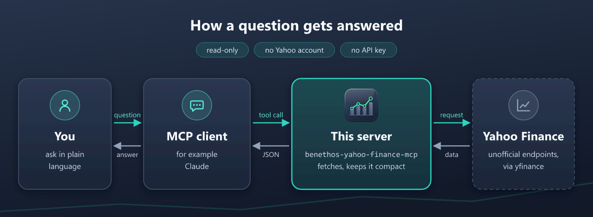

# Concept: architecture

Part of the [concept](../CONCEPT.md): section 3.

## 3. Architecture



The same path in the code (`assets/render_icon.py` draws the picture above):

```
MCP client (Claude)  --stdio / HTTP-->  transport/  -->  server.py (MCPServer)
                                                              |
                                                    tools/<subject>.py
                                                  (schemas + descriptions)
                                                              |
                                                    yahoo/<subject>.py  --> cache.py
                                              (yfinance calls, error mapping)
                                                              |
                                          yfinance --> query1/2.finance.yahoo.com
```

`cli.py` resolves the settings, sets up the log, builds the server and hands
it to a transport. `tools/` and `yahoo/` have the same eight modules, one per
subject (quotes, company, analysts, ownership, options, funds, browse,
screener), so `tools/options.py` exposes exactly what `yahoo/options.py`
fetches.
`tools/status.py` is the ninth and has no twin: `server_status` asks Yahoo
nothing and answers from the process itself.

| Module | Responsibility |
|--------|----------------|
| `cli.py` | Command-line parser and `main()`: resolve settings, configure the log and the cache, build the server, hand it to `run_stdio` or `run_http`. |
| `__main__.py` | Enables `python -m benethos_yahoo_finance_mcp` (delegates to `cli.main`). |
| `settings.py` | Every `YF_MCP_*` variable and flag, resolved once into a `Settings` dataclass (flag > env > default), plus the default cache TTLs. The only module that reads the environment, apart from `NO_COLOR`, a terminal convention `logbook/formats.colours_wanted` reads for itself. |
| `server.py` | The server's identity and instructions, `build_server()`, and the `call_tool` override that logs refused arguments. |
| `prompts/` | The prompts a client offers a person, recipes in plain text that chain the tools (see §7a). `_base.py` holds the abstract `Prompt`, the `Symbol` argument and the shared `RESOLVE` and `RULES` texts, and each prompt is a subclass in the module of its name: `asset_analysis.py`, `compare.py`, `earnings_preview.py`, `etf_profile.py`, `dividend_calendar.py`, `find_symbol.py`. They ask Yahoo nothing and import nothing of the package. |
| `tools/` | The tools a client sees, thin: parameters, descriptions, and a call to the yahoo function of the same name. `_base.py` holds the `Symbol` parameter, the shared annotations and `register_tool`, which wraps every tool with its log line. `status.py` holds `server_status`, the one tool with no yahoo twin and no log line. |
| `yahoo/` | All yfinance usage, one module per subject. `tickers.py` builds the `Ticker` and holds the error mapping every subject shares. The only package that imports yfinance. |
| `cache.py` | Opt-in persistent result cache (SQLite) with per-tool TTLs. Off until `configure(settings)` enables it. |
| `formatting.py` | Convert pandas/yfinance output to compact, JSON-safe values. |
| `logbook/` | Every log line, as a function, and the one stderr handler. The only package that imports `logging` (see §4). |
| `transport/` | `stdio.py`, and `http.py`: the HTTP app with the DNS-rebinding policy and the optional bearer guard in front, served by uvicorn. stdio never touches the HTTP half. |
| `errors.py` | `ToolError`, `SymbolNotFoundError`, `RateLimitError`. |
| `py.typed` | PEP 561 marker. Without it a type checker skips the installed package and every annotation in it goes unused. |

### Layers

Each top-level module or package imports exactly what its row names.
`tests/test_layers.py` reads every import from the source and checks it
against this table, both ways, and it checks that this table and its own
copy agree, so a new module needs a row in both and a new or dropped import
changes its row.

<!-- layers:start -->
| Unit | May import |
|------|------------|
| `__init__.py` | — |
| `errors` | — |
| `settings` | — |
| `logbook` | — |
| `formatting` | — |
| `cache` | `__init__.py`, `settings`, `logbook` |
| `yahoo` | `errors`, `logbook`, `cache`, `formatting` |
| `tools` | `errors`, `logbook`, `yahoo` |
| `prompts` | — |
| `server` | `__init__.py`, `tools`, `prompts`, `logbook` |
| `transport` | `settings`, `logbook` |
| `cli` | `__init__.py`, `settings`, `logbook`, `cache`, `server`, `transport` |
| `__main__` | `cli` |
<!-- layers:end -->

`tools` never imports `formatting`: a tool returns what yahoo built. Only
`__main__` imports `cli`, and only `yahoo` imports yfinance. Packages are
entered only through their `__init__.py`: a name taken from another package
must be in its `__all__`, and no import reaches into another package's
submodules.
